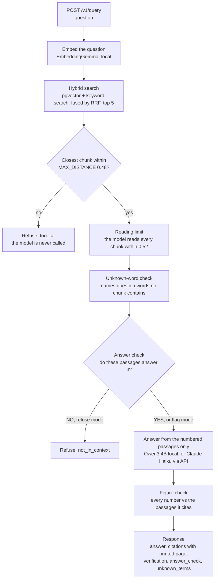
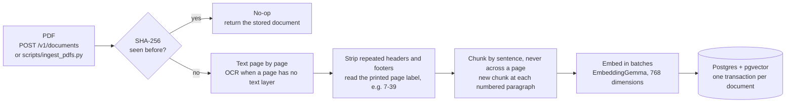
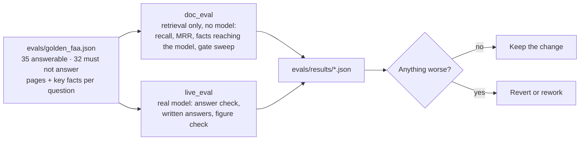
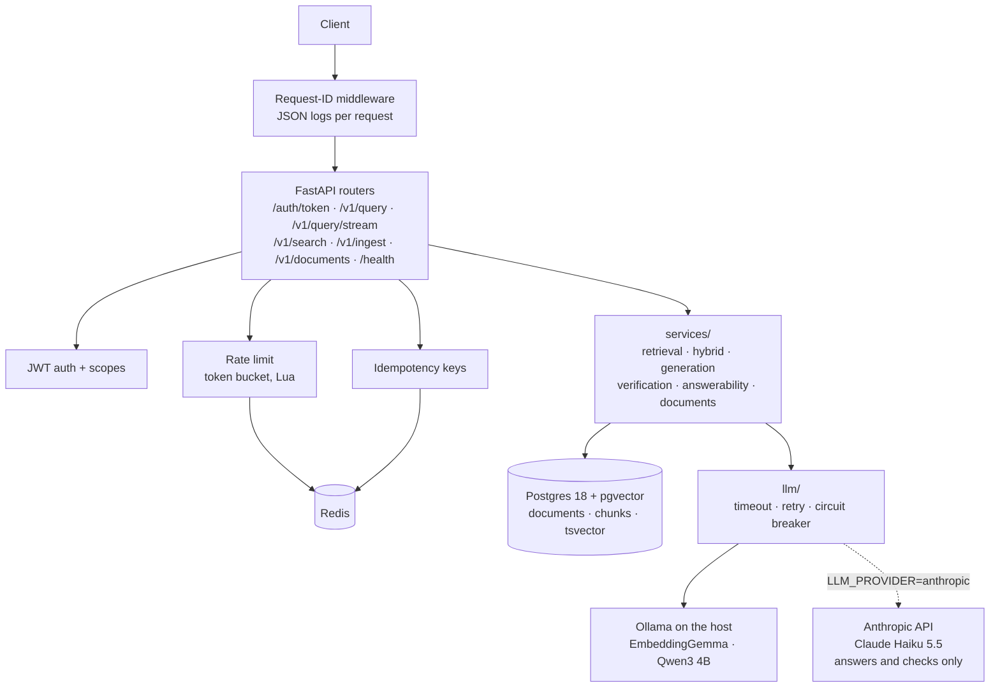

# AeroIntel

Aviation maintenance RAG (retrieval-augmented generation), built locally, stage by
stage. Every stage is proven by its own verify script before the next one starts.
This isn't a demo wired together in an afternoon — it's a real system, grown one
verified layer at a time, from raw embeddings to a versioned HTTP API to (eventually)
a Kubernetes deployment with observability and hardening.

**Core rule, unchanged since Stage 2:** the model never answers from its own
knowledge. It only sees numbered context blocks pulled from the database, and if
nothing in the database is close enough to the question, the model is never even
called — the refusal is structural, enforced by code, not by asking nicely in a
prompt.

## Results at a glance

Measured on a real manual, FAA **AC 43.13-1B CHG 1** (756 pages, 1,749 chunks), with a
golden set of **35 answerable questions** (24 written with the checker, 11 written
independently by the project owner) and **32 that must not be answered** (3 generic, 6
outside the manual, 23 *near-topic*: the manual covers the subject in its own words
but not the figure asked for). Last measured 2026-10-20.

| What | Result |
|---|---|
| Right page in the top 5 (hybrid search, 35 questions) | **1.000** recall@5 · MRR 0.859 (0.943 · 0.867 before the [keyword fix](#keyword-search-all-words-versus-any-word)) |
| Answer passage reaches the model (reading limit 0.52) | **34 of 35** (all 24 original) |
| Refused before any model call (distance gate) | 15 of 32 must-not-answer questions |
| Caught after the gate (answer check), Claude Haiku 5.5 | **17 of 17** — and its answers declined all 17 |
| Caught after the gate, local Qwen3 4B | 16 of 17 |
| Figures in answers not found in the cited passage (Haiku) | **0 of 24** answers with numbers |

Near-topic questions are the hard case: 12 of them sit *closer* to the manual than many
right answers (distance 0.33–0.47), so no distance threshold can separate them. They
are caught by reading the passages, not by distance. See
[Answer models compared](#answer-models-compared) for the full table.

## Status

| Stage / Phase | What it proved | State |
|---|---|---|
| Stage 0 — local inference | Ollama running Qwen3 (generation) and EmbeddingGemma (768-dim embeddings) on the host | ✅ verified |
| Stage 1 — pgvector persistence | Embeddings round-trip through Postgres/pgvector correctly (8/8 checks) | ✅ verified |
| Stage 1D — semantic ranking | Cosine search ranks by actual meaning, not luck (6/6 checks) | ✅ verified |
| Stage 2 — cited generation + refusal | Distance-ceiling gate + forced `[n]` citations + structural refusal (6/6 checks) | ✅ verified |
| Phase 0 — application skeleton | Same RAG behavior, now a real FastAPI service: async SQLAlchemy + Alembic, timeout/retry/circuit-breaker around Ollama, structured JSON logs, Docker, CI | ✅ verified |
| Phase 1 — hybrid retrieval + eval | Postgres full-text keyword search + pgvector merged via Reciprocal Rank Fusion, cross-encoder reranker, prompt registry, embedding-version tracking, golden-set eval harness (recall@k, MRR, faithfulness) in CI | ✅ verified |
| Phase 2 — production API layer | Redis rate limiting ✅ (token bucket per client, atomic Lua script, fail-open circuit breaker, 429 + `Retry-After`) · JWT auth with scopes ✅ · idempotency keys on `/v1/ingest` ✅ · SSE streaming of answers ✅ · semantic response cache still to do | 🚧 in progress |
| Phase 3 — event-driven ingestion | Redis Streams saga, dead-letter queue, outbox pattern, scheduled re-indexing | not started |
| Phase 4 — data layer at scale | Real PDF ingestion with page-level citations ✅ (upload endpoint + CLI, duplicate-file detection, OCR fallback, paragraph-aware chunking) · page-scored eval on a 35-question FAA golden set ✅ · reading limit past the gate ✅ · HNSW index, collections, pgBouncer, read replica, MinIO still to do | 🚧 in progress |
| Trust layer | Figure check against cited passages ✅ · unknown-word check ✅ · answer check ("do these passages answer it?") ✅ · local or Anthropic model for answers, measured side by side ✅ · warnings, revision awareness still to do | 🚧 in progress |
| Phase 5 — deploy & infrastructure-as-code | Local `kind` Kubernetes cluster, Helm charts, Terraform, canary/blue-green deploys | not started |
| Phase 6 — observability | Prometheus, Grafana, OpenTelemetry traces, Jaeger, k6 load tests, SLO/error-budget dashboard | not started |
| Phase 7 — security & hardening | Keycloak OIDC, TLS via mkcert, SOPS-encrypted secrets, audit log, OWASP Top-10 pass | not started |

> **Last verified end-to-end:** 2026-10-20 — the non-local suite passes on the
> developer machine with real Postgres and Redis (420+ tests; ruff, ruff-format and
> mypy clean); live evaluations against the manual with local Qwen3 4B, Phi-4-mini,
> Gemma 3 4B and Claude Haiku 5.5 are saved under `evals/results/`.

> **Full Phase 0 walkthrough:** [docs/PHASE_0.md](docs/PHASE_0.md) — what every
> file does and why, concept by concept.

### A note on the data

The live database holds one real, public document: FAA Advisory Circular
**AC 43.13-1B CHG 1** (*Acceptable Methods, Techniques, and Practices — Aircraft
Inspection and Repair*), fetched by `scripts/fetch_sample_docs.ps1`. The 6 synthetic
chunks in `scripts/load_sample_data.py` are placeholder text kept only for the
original `run_eval` harness and the tests; they are not loaded into the live
database, so they can never be cited next to the manual. AeroIntel is a reference
finder that shows its sources, not an airworthiness authority.

## How a request flows



Two decisions are kept apart on purpose. **Answer at all?** is decided in code by the
closest chunk's distance (structural refusal: the model cannot talk its way past it).
**Read what?** is every retrieved chunk up to a slightly looser reading limit, so an
answer passage ranked just past the gate is not lost. The answer check and the figure
check then judge the passages and the answer, not the topic.

Every model call goes through timeout → retry with backoff → circuit breaker, so a
slow or dead model fails fast instead of hanging the API.

### How a document gets in



### How quality is measured



Every change to chunking, retrieval, prompts or models in this repository went through
this loop, and several were rejected by it (top_k 8, a cross-encoder reranker, two
prompt rewrites — see `evals/results/` and the commit history).

## Architecture



Embeddings always stay local; with `LLM_PROVIDER=anthropic` only the answer and the
answer check go to the API (passages leave the machine, so use it only for documents
that may).

`core/` holds the cross-cutting pieces: `config.py` (typed settings from env/`.env`,
no defaults for secrets), `logging.py` (structlog JSON + request-ID middleware),
`resilience.py` (the retry + circuit-breaker primitives).

## Tech stack

| Layer | Tech |
|---|---|
| API | FastAPI, Uvicorn, pydantic-settings |
| Data | PostgreSQL 16, pgvector, SQLAlchemy 2.0 (async), Alembic |
| AI / retrieval | Ollama, Qwen3 (generation), EmbeddingGemma (768-dim embeddings) |
| Resilience | Hand-rolled retry + circuit breaker (`app/core/resilience.py`), httpx timeouts |
| Ops | structlog (JSON logs + request IDs), Docker, Docker Compose, GitHub Actions CI |
| Test / lint | pytest, pytest-asyncio, ruff, mypy |
| Rate limiting / messaging | Redis (token buckets now; Streams in Phase 3) |

## Project structure

```text
app/
  main.py              app factory + lifespan (startup/shutdown)
  core/
    config.py           typed Settings, env/.env driven
    logging.py           structlog JSON logs, RequestIdMiddleware
    resilience.py         retry() with backoff, CircuitBreaker
    rate_limit.py          Redis token bucket (Lua), fail-open/closed on Redis outage
  api/
    deps.py              FastAPI dependencies (DB session, Ollama client, rate limit)
    health.py             /health/live, /health/ready
    v1/router.py           /v1/query, /v1/query/stream, /v1/search, /v1/ingest, /v1/documents
  db/
    base.py               async engine + session factory
    models.py              Document, DocumentChunk (pgvector column, JSONB metadata, page)
  llm/
    ollama.py              OllamaClient: embed() + chat(), resilience-wrapped
    anthropic.py           answers + checks via the Anthropic API (LLM_PROVIDER=anthropic); embeddings stay local
  schemas/                 pydantic request/response contracts
  services/
    retrieval.py            search_chunks() — embed + pgvector search
    generation.py            answer_question() — distance gate + grounded generation
    ingestion.py             ingest_chunk() — embed + store one text chunk
    documents.py             ingest_pdf() — PDF -> page-bound chunks -> embed -> store
    pdf_text.py               PDF text extraction, header/footer cleanup, chunking
    ocr.py                    optional OCR for scanned pages (tesseract + PyMuPDF)
    context.py                 optional: add the chunk(s) after each hit to the prompt

evals/                    scoreboards: run_eval (sample corpus, by chunk id) and
                          doc_eval (real documents, scored by page; golden_faa.json)
alembic/                  versioned schema migrations
scripts/                  original stage scripts (ask.py, verify_*.py, ...) — still work;
                          ingest_pdfs.py and fetch_sample_docs.ps1 for real documents
tests/                    pytest suite (unit, integration, local-Ollama)
sql/                      original raw-SQL schema (pre-Alembic reference)
docs/PHASE_0.md           file-by-file walkthrough of Phase 0
.github/workflows/ci.yml  lint + test on every push
docker-compose.yml        postgres (pgvector) + redis + api
Dockerfile                multi-stage, non-root user
```

## Run it from scratch

Prerequisites: Python 3.11, Docker Desktop, Ollama with `embeddinggemma` and
`qwen3:4b-instruct` pulled.

```powershell
# 0. One-time: create the virtualenv and install dependencies
python -m venv .venv
.venv\Scripts\Activate.ps1
pip install -r requirements.txt -r requirements-dev.txt

# 1. Configure: copy .env.example to .env and set POSTGRES_PASSWORD
Copy-Item .env.example .env   # then edit .env

# 2. Start the stack (Postgres + Redis + API)
docker compose up -d --build

# 3. Apply schema migrations (first time only, from the host)
alembic upgrade head

# 4. (Optional) load the 6 synthetic sample chunks
python scripts/load_sample_data.py

# 5. Check it is alive (curl.exe, NOT curl — in PowerShell "curl" is an
#    alias for Invoke-WebRequest with different flags)
curl.exe http://localhost:8000/health/live     # {"status":"ok"}
curl.exe http://localhost:8000/health/ready    # {"status":"ready"} = DB reachable
```

Interactive API docs: http://localhost:8000/docs

## API reference

| Endpoint | What it does |
|---|---|
| `POST /auth/token` | Trade a client id + secret for a short-lived access token. Rate limited by IP. |
| `POST /v1/query` | Full grounded pipeline: embed → search → distance gate → generate with citations, or a structural refusal. Refusal is a normal `200` (`"refused": true`) — a successful outcome of the contract, not an error. |
| `POST /v1/query/stream` | Same pipeline as `/v1/query`, but the answer arrives as Server-Sent Events, token by token. See [Streaming answers](#streaming-answers-phase-2). |
| `POST /v1/documents` | Upload a PDF (multipart, `ingest` scope). It is read, cut into page-bound chunks, embedded and stored; answers then cite document and page. See [Document ingestion](#document-ingestion-phase-4). |
| `POST /v1/search` | Semantic search only. No generation, no LLM call. |
| `POST /v1/ingest` | Embed and store one chunk of text with metadata. Needs the `ingest` scope. |
| `GET /health/live` | Is the process up? Checks nothing — always `200` if alive. |
| `GET /health/ready` | Can we serve traffic? Verifies the database is reachable; `503` if not. |

### Authentication (Phase 2)

Every `/v1/*` call needs `Authorization: Bearer <token>`. Get a token by
posting a client id and secret to `/auth/token`:

```powershell
'{"client_id":"admin","client_secret":"<secret>"}' | Set-Content t.json
curl.exe -X POST http://localhost:8000/auth/token -H "Content-Type: application/json" -d "@t.json"
# -> {"access_token":"eyJ...","token_type":"bearer","expires_in":3600,"scope":"ingest query"}
```

Clients and their scopes are defined in `AUTH_CLIENTS` (see `.env.example`).
Two scopes: **`query`** (`/v1/query`, `/v1/search`) and **`ingest`**
(`/v1/ingest`, which changes what every later answer is grounded in, so give it
sparingly). A token can ask for a narrower scope than its client holds, never a
wider one. No/invalid token → `401`; valid token without the scope → `403`.

| Setting | Default | What it does |
|---|---|---|
| `JWT_SECRET` | *(none)* | Signs tokens. Required, 32+ characters; the API refuses to start without it. |
| `AUTH_CLIENTS` | *(empty)* | JSON map of `client_id` → `{secret, scopes}`. |
| `AUTH_ENABLED` | `true` | `false` removes the token requirement (local experiments only). |
| `JWT_TTL_SECONDS` | `3600` | Token lifetime. |
| `JWT_ISSUER` / `JWT_AUDIENCE` | `aerointel` / `aerointel-api` | Checked on every token. |

Design notes: signature, expiry, issuer, audience and subject are all
*required* claims (a token without an expiry would live forever); the accepted
algorithm is pinned to the configured one, so an `alg: none` or
algorithm-swapped token is rejected; verification lives in one function, so
Phase 7's Keycloak can replace the issuer without touching any route; and
secrets are compared in constant time. The JWT secret is checked when the API
starts, not when settings load, so `alembic` and the scripts don't need it.

### Idempotency keys (Phase 2)

`POST /v1/ingest` creates a row. If a connection drops after the server stored
the chunk but before the client saw the answer, a plain retry stores it twice —
and a duplicated chunk quietly outranks its neighbours in retrieval. Send an
`Idempotency-Key` header (any unique string, 1–128 characters of `A-Z a-z 0-9 . _ : -`,
e.g. a UUID) and retries become safe:

```powershell
$key = [guid]::NewGuid().ToString()
curl.exe -X POST http://localhost:8000/v1/ingest -H "Authorization: Bearer $token" `
  -H "Idempotency-Key: $key" -H "Content-Type: application/json" -d "@chunk.json"
# run it again with the same $key: same response, plus "Idempotent-Replay: true",
# and nothing is stored a second time
```

| Situation | Result |
|---|---|
| First request with a key | Runs normally; the response is remembered for 24 h. |
| Same key + same body again | The remembered response, header `Idempotent-Replay: true`. Nothing is embedded or stored. |
| Same key, **different** body | `422` — a reused key is a client bug, so it is rejected rather than silently answered. |
| Same key while the first is still running | `409` with `Retry-After: 1`. |
| First attempt failed or the client hung up | The key is released; the retry runs normally. |
| Redis unreachable, key sent | `503` and nothing is stored. A key means "exactly once", so it refuses rather than risk a duplicate. (Rate limiting does the opposite and fails open.) |
| No key sent | Unchanged from before. |

Keys are private to the caller that made them, and are bound to a fingerprint
of the request body (key order in the JSON doesn't matter).

| Setting | Default | What it does |
|---|---|---|
| `IDEMPOTENCY_ENABLED` | `true` | `false` ignores the header entirely. |
| `IDEMPOTENCY_TTL_SECONDS` | `86400` | How long finished responses are remembered. |
| `IDEMPOTENCY_LOCK_SECONDS` | `150` | How long a running request holds its key; a crashed server can't block a key longer than this. Keep it above the slowest legitimate ingest (embed timeout × retries). |

Design notes: the claim is a single Redis `SET NX`, so of any number of
simultaneous requests with one key exactly one runs (a test fires 12 at once and
asserts one insert). Each claim carries a random token and is released by a Lua
script that checks it, so a slow request can't delete the claim of whoever took
the key after it. The release is shielded from cancellation, because a client
hanging up cancels the request mid-work.

### Streaming answers (Phase 2)

`POST /v1/query/stream` takes the same body as `/v1/query` (needs the `query`
scope) and replies with `Content-Type: text/event-stream`. Retrieval and the
refusal gate run **before** the first byte, so a bad request, missing scope,
rate limit or retrieval failure is an ordinary HTTP error. After that the
stream is a fixed sequence of events, each with a one-line JSON payload:

| Event | Payload | When |
|---|---|---|
| `meta` | `question`, `refused`, `refusal_reason`, `refusal_message`, `unknown_terms`, `chunks` (the sources), `prompt_version` | Always first. The sources arrive before the answer, so a UI can show them while it types. |
| `token` | `{"text": "..."}` | Repeated; concatenate the `text` values to build the answer. |
| `verification` | same object as `/v1/query`'s `verification` (see [Checking the answer](#checking-the-answer-trust-layer)) | Only when the answer contained figures or citations to check, just before `done`. The text has already been sent, so with `VERIFY_MODE=block` a `blocked: true` means "discard what you received". |
| `done` | `{"refused": bool, "answer_chars": n}` | Last event on success. |
| `error` | `{"detail": "Answer generation failed."}` | Only if generation fails after the stream began (the `200` is already sent). No `done` follows; details go to the logs, not the stream. |

A refusal is just `meta` (`refused: true`) then `done`; the model is never
called, exactly as for `/v1/query`. If the client disconnects mid-answer,
generation stops and the connection to Ollama is closed.

```powershell
'{"question":"what should I check if hydraulic pressure drops?"}' | Set-Content q.json
curl.exe -N -X POST http://localhost:8000/v1/query/stream -H "Authorization: Bearer $token" -H "Content-Type: application/json" -d "@q.json"
# or: .\scripts\try_api.ps1 stream "what should I check if hydraulic pressure drops?"
```

Notes for client authors: it is a `POST`, so the browser `EventSource` API
(GET only, no headers) cannot call it; use `fetch` and read `response.body`.
Opening the stream to Ollama is protected by the same timeout / retry / circuit
breaker as `/v1/query`, but a failure *mid-stream* is not retried (a retry would
restart the answer and duplicate text). The per-chunk read timeout
(`OLLAMA_TIMEOUT_SECONDS`) ends a stream whose model goes silent.

### Document ingestion (Phase 4)

Upload a PDF and ask questions about it; answers cite the document and the page.

```powershell
alembic upgrade head                                   # once: adds the documents table
.\scripts\fetch_sample_docs.ps1                        # free FAA manual (AC 43.13-1B, 756 pages)
python scripts\ingest_pdfs.py data\aviation --dry-run   # check how it reads, stores nothing
python scripts\ingest_pdfs.py data\aviation             # read, chunk, embed, store
python scripts\ingest_pdfs.py data\aviation --replace   # re-ingest stored files with the current chunking
```

Or over HTTP, for smaller files (the request stays open until embedding is done):

```powershell
curl.exe -X POST http://localhost:8000/v1/documents -H "Authorization: Bearer $token" -F "file=@data\aviation\AC_43.13-1B_CHG_1.pdf" -F "title=AC 43.13-1B"
```

What happens to a file:

1. **Deduplication.** The SHA-256 of the file's bytes is looked up first. A file
   ingested before is skipped (`duplicate: true`), whatever it is now called.
2. **Reading.** The PDF's own text layer is read page by page. Running headers
   and footers (lines that repeat on a quarter or more of the pages, ignoring
   changing digits) are removed so they do not pollute every chunk. The page
   number printed on the page ("3-3", "xii") is read from it when present.
3. **OCR (optional).** Pages with no text layer are read with tesseract if
   `OCR_ENABLED=true`. Without OCR, a fully scanned PDF is rejected with a clear
   message instead of being stored empty.
4. **Split words.** Some text layers put a space inside a word ("C onduits wi ll",
   "Kink ing", "CA UTION"). With `PDF_REPAIR_SPLIT_WORDS=true` two neighbouring
   pieces are joined when the joined word occurs elsewhere in the same document
   and one piece is rare on its own, so "a round hole" stays as it is. On AC
   43.13-1B this makes 142 joins, none of them wrong; it matters for keyword
   search, which cannot match "conduits" against "C onduits". Off by default;
   new ingests only.
5. **Chunking.** Each page is cut into chunks of about `CHUNK_MAX_CHARS`
   (1200) characters ending on sentence boundaries, with `CHUNK_OVERLAP_CHARS`
   (150) repeated at the start of the next one. A chunk never crosses a page, so
   every citation names exactly one page. With `CHUNK_BY_PARAGRAPH=true` (off by
   default) a chunk also starts at each numbered paragraph heading ("6-181.
   TITANIUM AND TITANIUM ALLOYS.", "SECTION 11."), overlap never crosses a
   heading, and a last chunk that would add under 200 new characters is folded
   into the one before. Figure and table captions ("FIGURE 11-30."), references
   ("Figures 11-11 through 11-13.") and table-of-contents lines are not headings,
   and a heading within 200 characters of the previous cut stays with it, so a
   section title keeps its first paragraph. Each chunk records how it was cut
   (`metadata.chunking`: `sentences` or `paragraphs`).
6. **Storing.** All chunks are embedded in batches, then the document and its
   chunks are written in one transaction: a file is fully ingested or not at all.
   The database connection is released before the slow reading and embedding.
   `ingest_pdfs.py --replace` re-ingests a file that is already stored (to apply
   new chunking settings): the old copy and its chunks are deleted in that same
   transaction, so a failed re-ingest leaves the old copy in place. The document
   gets a new id.

Each stored chunk records its document, its position, the PDF page and the
printed page. `/v1/query` and `/v1/search` return them (`document_id`, `page`,
`page_label`), and the model is told "Source: AC 43.13-1B, page 3-3 (PDF page
121)" so it can cite precisely.

OCR needs the tesseract program and PyMuPDF: `pip install -r requirements-ocr.txt`
plus tesseract on your PATH (on Windows: the UB-Mannheim installer). In Docker,
build with `INSTALL_OCR=true` and run with `OCR_ENABLED=true`.

Not yet built (see the roadmap): collections to keep topics apart, a vector index
for very large corpora, and background ingestion with progress. Until then, load
long manuals with the script rather than over HTTP.

#### Reading on: context widening (off by default)

A chunk ends on a sentence, often in the middle of a section, so the answer to a
question can continue in the chunk after the one that matched. (Example from the
FAA manual: the hit for "how do I inspect control cables?" ends at "c." and the
next chunk holds the cloth-wipe and magnifying-glass steps.) With
`CONTEXT_NEIGHBORS=1` each retrieved chunk that passes the distance gate is
followed in the prompt by the chunk after it from the same document.

- The distance gate runs first, on the real hits only, so widening can never turn
  a refusal into an answer. A neighbour carries its hit's distance.
- `CONTEXT_MAX_CHUNKS` (default 8) caps the prompt, hits included. The first
  following chunk of every hit is added before the second of any.
- A longer prompt needs a longer context window. Ollama silently drops what does
  not fit, so set `LLM_NUM_CTX=8192` when you turn this on; a prompt that may not
  fit is logged as `prompt may not fit the model context window`.
- Measure before enabling: `python -m evals.doc_eval --neighbors 1` reports
  `context_hit` (is a right page among what the model would read?) and the
  prompt size.

#### Reading past the gate: `CONTEXT_MAX_DISTANCE` (off by default)

`MAX_DISTANCE` answers two questions at once unless told otherwise: *answer at
all?* and *which chunks does the model read?* Two misses on the FAA manual came
from the second. The weld question passed the gate on one chunk (0.422), but the
chunk holding the answer ranked second at 0.495 and was dropped; the titanium
question lost its answer chunk at 0.486 the same way. With
`CONTEXT_MAX_DISTANCE=0.52` the gate is unchanged (a question whose *closest*
chunk is 0.495 is still refused, and the model is never called), but a question
that passes reads every retrieved chunk up to 0.52. A value below `MAX_DISTANCE`
is ignored; blank means "same as the gate". Measure it:
`python -m evals.doc_eval --retriever hybrid --context-max-distance 0.52`.
`--show` marks each retrieved chunk `[read]` or `[not read]`.

### Checking the answer (trust layer)

Two checks that need no extra model call, both reported in the `/v1/query`
response (and, for the stream, in `meta` and a `verification` event), and an
optional third that costs one short model call.

**Figures must be in the cited passages** (`VERIFY_MODE`, default `flag`). Every
number in the answer (0.032, 3/8, 1,000, 20-25) is looked up in the passages the
answer cites `[n]`; if it cites nothing valid, in all passages. A figure no cited
passage contains is listed in `verification.unsupported`; a figure present but with
another unit ("foot-pounds" for "inch-pounds") in `unit_mismatch`; a `[n]` pointing
at a block that was never given in `bad_citations`. Numbers the question itself
contains may be repeated; numbers inside identifiers (`AN960`, `A320`) are ignored.

| `VERIFY_MODE` | Effect |
|---|---|
| `off` | no check |
| `flag` (default) | the answer is returned with the findings |
| `block` | `/v1/query` withholds an answer that fails: `refused: true`, `refusal_reason: "unverified_numbers"`, the findings in `verification` (here the model *was* called; the answer is discarded afterwards). The stream cannot withdraw text already sent, so it sends `verification` with `blocked: true` |

What it cannot catch: a correctly copied figure from the wrong passage, the wrong
aircraft or condition, a conversion (0.375 for 3/8, reported on purpose: the prompt
asks for exact figures), or a wrong number written as a word. A model that
computes (adds two limits) is flagged too. It is a safety net under the
reader, not a replacement for reading the cited page.

**Words the documents never use** (`ANSWERABILITY_MODE`, default `off`). The
distance gate asks whether some chunk is *close* to the question, which is a topic
test: "repair a carbon fiber propeller blade" is close to a manual about
propellers. This check looks up each distinctive word of the question ("Airbus",
"Garmin", "GE90") in the full-text index and lists those found in no stored chunk
as `unknown_terms`. `flag` only reports them (also on a question the distance gate refused, where the
refusal message then names the words: "No stored document contains: ge90");
`refuse` also refuses a question the gate let through, without calling the model
(`refusal_reason: "unknown_terms"`). `ANSWERABILITY_MIN_CHUNKS`
(default 1) is how many chunks must contain a word for it to count as known, and
`ANSWERABILITY_MIN_UNKNOWN` (default 1) how many unknown words refuse a question.

It is measured, not assumed (`python -m evals.doc_eval` prints the table). On the
24 + 11 FAA questions: it catches the foreign-vocabulary questions, but both
aviation questions the distance gate let through (carbon fiber propeller,
helicopter rotor bolt) use only words the manual contains, so it does not catch them;
and it wrongly refuses one right question that uses a word the manual does not
("judging"). Keep it at `off` or `flag` until the golden set is larger.

**Does the context answer it?** (`ANSWER_CHECK`, default `off`). The near-topic
question has every word in the manual and sits as close to it as a real question
does, so neither check above can see it. Only reading the passages can. With
`ANSWER_CHECK=flag` the model is first asked, with the same numbered passages
it would answer from, to reply YES or NO (prompt `app/prompts/answer_check.v1.txt`);
the reply is reported as `answer_check` (`yes`, `no` or `unclear`) in the
response and in the stream's `meta`. `refuse` also refuses on `no`
(`refusal_reason: "not_in_context"`) without writing an answer. An unreadable
reply counts as `unclear` and never refuses. It runs only for questions the
distance gate and the word check let through, and adds one model call (about as
long as a short answer) to each of them.

It must be measured on the live model before `refuse` is used: a check that says
NO to right questions is worse than none. `python -m evals.live_eval` runs every
golden and off-topic question through the real model and reports how often the
check says NO to right questions (wrong refusals) and to off-topic ones the gate
let through (catches), whether the written answers to off-topic questions decline
(prompt rule 2), and which right answers the figure check flags (each one a
candidate false alarm; the answers are saved with `--save` so they can be read).

Measured 2026-10-18 (qwen3:4b-instruct, hybrid, `CONTEXT_MAX_DISTANCE=0.52`; 24 right
questions, 28 that must not be answered: 3 generic, 6 outside the manual, 19
*near-topic*, which the manual covers in its own words without giving the figure
asked for):

| | right questions: check says YES | gate misses (13): check says NO | written answers that decline |
|---|---|---|---|
| check prompt v1 | 23 of 24 (NO to "how reliable is a punch tester") | 13 of 13 | 13 of 13 |
| check prompt v2 | 24 of 24, three runs | 13 of 13, three runs | - |

12 of the 19 near-topic questions pass the distance gate (closest chunk 0.334-0.472,
closer than many right answers), so no `MAX_DISTANCE` separates them; prompt rule 2
already declined all of them without inventing a figure. v2 tells a request for a
*value* (YES only if the passages give it, not "use the recommended value") from a
request for an *explanation or judgement*. `ANSWER_CHECK_VERSION` pins the prompt
(default `v2`) so a new prompt file cannot change refusals before it is measured:
`python -m evals.live_eval --check-only --check-version vN`. With `ANSWER_CHECK=refuse`
the refusal no longer depends on the model obeying rule 2. v2 was written after
seeing the v1 miss, so its 24 of 24 is partly by construction; questions written by
someone else are the real test.

To see why a question retrieves what it does:

```powershell
python -m evals.doc_eval --show titanium-oxide-colours    # the chunks, their pages, and where each fact is
python -m evals.doc_eval --show all
```

### Rate limiting (Phase 2)

Every `/v1/*` request spends one token from its client's bucket in Redis.
Defaults: bursts of up to **20** requests, then a sustained **30/minute**
(`0.5` tokens/second). An empty bucket returns `429 Too Many Requests` with a
`Retry-After` header (whole seconds until a token is back); every allowed
response carries `X-RateLimit-Limit` and `X-RateLimit-Remaining`. `/health/*`
is never limited, so a load balancer's probes can't get the service marked dead.

| Setting | Default | What it does |
|---|---|---|
| `RATE_LIMIT_ENABLED` | `true` | `false` switches limiting off entirely. |
| `RATE_LIMIT_CAPACITY` | `20` | Bucket size = the largest burst allowed. |
| `RATE_LIMIT_REFILL_PER_SECOND` | `0.5` | Sustained rate (0.5/s = 30/min). |
| `RATE_LIMIT_FAIL_OPEN` | `true` | Redis down: `true` lets requests through (logged as degraded), `false` returns `503`. |
| `REDIS_URL` | `redis://localhost:6379/0` | Set to `redis://redis:6379/0` inside Docker Compose (already done in `docker-compose.yml`). |

Design notes: the bucket lives in Redis rather than in process memory because
every worker/replica must share one budget; the refill-and-spend step is a
single Lua script so concurrent requests can't race past the limit (a test
fires 25 concurrent requests at a 5-token bucket and asserts exactly 5 get
through); Redis calls have a 0.5 s timeout plus a circuit breaker, so a dead
Redis costs a few fast failures, not a slow API. Authenticated clients are
identified by their token's subject, so a budget follows the caller across IP
addresses; `/auth/token` itself (no token yet) is limited by IP. A client-sent
header is never trusted for identity, since anyone could change it to reset
their own limit.

### Try it

Easiest: the interactive docs at http://localhost:8000/docs ("Try it out"). Or with
`curl.exe`, putting JSON in a temp file to avoid PowerShell quoting pain:

```powershell
'{"question":"engine shaking while ascending"}' | Set-Content q.json
curl.exe -X POST http://localhost:8000/v1/query -H "Content-Type: application/json" -d "@q.json"
del q.json
```

### Logs

```powershell
docker compose logs -f api        # live JSON logs with request IDs
docker compose ps                 # container status/health
docker compose logs postgres      # database logs
```

## Phase 1: retrieval quality

Both retrieval upgrades are feature-flagged and **off by default**, so the
system behaves exactly as it did in Phase 0 until you turn them on.

| Setting | Default | What it does |
|---|---|---|
| `HYBRID_ENABLED` | `false` | Runs Postgres full-text keyword search (`ts_rank`; not true BM25: no weighting of rare words) alongside vector search and merges the two rankings with Reciprocal Rank Fusion. Catches exact terms (part numbers, `2.5 bar`) that embeddings generalise away. |
| `KEYWORD_QUERY` | `any` | How the keyword half reads the question: `any` = a chunk matching any distinctive question word (OR), ranked by how many it matches; `all` = every word must match (AND), which matched nothing for 27 of 35 questions. |
| `RERANKER` | `none` | `crossencoder` re-scores the top `RERANK_CANDIDATES` with a model that reads query and chunk together. Needs `pip install -r requirements-rerank.txt`. |
| `PROMPT_VERSION` | unset | Pins a prompt version (e.g. `v1`); unset uses the newest file in `app/prompts/`. |

### Prompts are versioned files

Grounding instructions live in `app/prompts/<name>.<version>.txt`, not as
string literals. Rewording means adding `v2.txt` — a reviewable diff, with
`v1` still runnable beside it. Each prompt carries a sha256 of its bytes,
so editing `v1` in place is detectable: the checksum moves, and last
month's eval numbers are visibly no longer comparable rather than quietly
misleading. Every answer, log line and eval report names the exact prompt
that produced it (`grounded_answer@v1:2118f53d`).

### Embedding version tracking

Every row records the model that produced its vector in `embedding_model`.
Vectors from different models are not comparable, so a model swap is a
deliberate migration, not an accident:

```powershell
python scripts/backfill_embeddings.py --dry-run          # what would change
python scripts/backfill_embeddings.py                    # tag untagged rows
python scripts/backfill_embeddings.py --model newmodel   # re-embed under a new model
```

Rows keep their old tag until re-embedded, so a crash midway leaves a
visible mix rather than a silently corrupted index. Flip `EMBEDDING_MODEL`
only after a clean run.

### Measuring retrieval quality

```powershell
python -m evals.run_eval                                   # vector baseline
python -m evals.run_eval --retriever hybrid                # + keyword search/RRF
python -m evals.run_eval --retriever hybrid --reranker crossencoder
python -m evals.run_eval --faithfulness                    # + hallucination check
```

Reports `recall@k` and `MRR` against `evals/golden_set.json`, and exits
non-zero if `recall@5` falls below the threshold. `--faithfulness` also
generates an answer per question and grades it two ways:

- **Citation validity** — deterministic and free: every `[n]` the answer
  cites must point at a CONTEXT block that was actually supplied. A model
  citing `[4]` when handed three blocks invented a source, and the run
  fails. This is the check safe to gate on.
- **Judge faithfulness** — an LLM reads (context, answer) and rules on
  whether every claim is supported. It is itself a fallible model, so
  treat a drop as a prompt to go read the answers, not a number to
  optimise blindly. An unparseable verdict scores `None`, not `0` — a
  broken judge must not be recorded as a hallucinating model.

CI cannot measure real quality (no Ollama on the runner), so it guards the
**harness** instead: `tests/test_eval_harness.py` drives the whole scoring
path against Postgres with deterministic stub vectors. A silently broken
scoreboard is how a regression reaches main unnoticed.

## Tests

```powershell
pytest -m "not local" -v   # unit + API contract + pgvector ranking (runs in CI)
pytest -m local            # full RAG tests, need real Ollama (~30s)
ruff check app tests       # lint
ruff format app tests      # auto-format
mypy app                   # type check
```

CI (`.github/workflows/ci.yml`) runs lint (ruff + mypy) and the non-local tests
against a real pgvector service container on every push.

| Test file | What it proves | Needs |
|---|---|---|
| `tests/test_resilience.py` | Retry recovers from transient failures, gives up after the last attempt; breaker opens after N failures, fails fast while open, recovers via a successful probe | nothing — pure asyncio |
| `tests/test_health.py` | Liveness works, every response carries `x-request-id`, empty questions are rejected with `422` before touching services | nothing |
| `tests/test_search_synthetic.py` | pgvector ranks by meaning using orthogonal synthetic vectors — no real embedding model needed to prove the math | Postgres only (CI) |
| `tests/test_rag_local.py` | Full grounding contract with real Ollama: matched question → cited answer, unmatched question → refusal | Ollama + Postgres |
| `tests/test_streaming.py` | Ollama stream parsing (ordering, whitespace trimming equals `chat()`, error lines, retry/circuit rules, connection closed on early stop); SSE format; the `/v1/query/stream` event sequence, refusal never reaching the model, in-band errors that don't leak, auth/scope/validation, and client disconnect ending generation (ASGI 2.3 and 2.4 styles) | Redis for the endpoint tests |
| `tests/test_pdf_text.py` | Page-number reading, header/footer removal, hyphenation, sentence-bound chunking with overlap, paragraph-aware chunking (the real page 349 titanium case, captions and references that are not headings, sliver folding), split-word repair (real splits from the manual, two real words left alone), chunks never crossing pages, unreadable/encrypted/scanned PDFs, and real OCR on a scanned page | nothing (OCR test needs tesseract + PyMuPDF, else skipped) |
| `tests/test_documents.py` | PDF ingestion service (dedup, connection released before embedding, batches, concurrent-upload race, nothing half-stored, the chunking setting reaching the chunker, `--replace` deleting the old copy in the same write), the upload endpoint (type, size, scope), page info in search results and prompts, and against real Postgres: duplicate skip, page provenance, cascade delete, replace swapping the stored copy, a failed replace keeping the old one | Redis (endpoint), Postgres (integration) |
| `tests/test_context.py` | Which following chunks are planned (budget spread over the hits, no duplicates), widening after the distance gate and before the session is released, refusals untouched, the context-window warning, `num_ctx` sent only when set, and against real Postgres: neighbour order, document boundaries, last chunk | Postgres (integration) |
| `tests/test_context_ceiling.py` | The reading limit (an answer chunk past the gate is read only when the question passed on another chunk; never tightens the gate; hybrid order), the answer check (reply parsing, `off`/`flag`/`refuse` call order, never runs for a refused question, judges the widened set) and its `/v1/query` and stream fields | Redis for the endpoint tests |
| `tests/test_live_eval.py` | The live eval's decline heuristic and counts, and one full run against fakes | nothing |
| `tests/test_verification.py` | Number extraction (decimals, fractions, thousands, ranges, units, identifiers), a faithful answer passing, one altered digit or unit caught, citations, question echo, `flag`/`block`/`off` through `answer_question`, and the `/v1/query` response shape | Redis for the endpoint tests |
| `tests/test_answerability.py` | Which question words are tested, spelling variants, the word counts against real Postgres (invented words), and `prepare_answer`: `refuse` never builds a prompt, `flag` reports, `off` never looks, a question the distance gate refused is not checked | Postgres (integration) |
| `tests/test_doc_eval.py` | Page-based scoring (hit, rank, reaches-the-prompt, context hit), gate judged on the closest *served* chunk, the reading limit in scoring and sweeps, old result files still readable, off-topic refusal, the `MAX_DISTANCE` sweep and suggested ceiling, the answerability sweep and combined sweep, the `--show` text, and the golden file's well-formedness | nothing |
| `tests/test_eval_metrics.py` | Eval metric math (recall@k, MRR, aggregation) + golden-set well-formedness | nothing |

## Retrieval evals (the scoreboard)

Before and after any retrieval change, run the eval harness and compare
numbers — never judge retrieval quality by eyeballing a few queries:

```powershell
python -m evals.run_eval   # needs Postgres (with sample data) + Ollama
```

It runs every question in `evals/golden_set.json` through the live
retrieval pipeline and reports recall@1/3/5 and MRR per question, plus
means. The eval exits 1 if mean recall@5 drops below 0.9.

**Baseline (vector-only retrieval, 12-question golden set):**

```text
recall@1=0.667  recall@3=1.000  recall@5=1.000  MRR=0.833
```

**Hybrid (keyword search + pgvector + RRF, `--retriever hybrid`):**

```text
recall@1=0.667  recall@3=1.000  recall@5=1.000  MRR=0.833
```

An honest, instructive result: on this corpus hybrid changes nothing. The
four rank-2 misses are paraphrase questions where the competing chunk is
*semantically* close (same system, different section) — a ranking problem,
not a recall problem. Keyword overlap can't fix that; a cross-encoder
reranker reading the full text can. That is step 3. Hybrid stays in the
codebase behind `HYBRID_ENABLED` because it will matter once the corpus
grows to contain exact-term content (error codes, part numbers) that
embeddings miss.

### Real documents: scored by page

`run_eval` scores the 6 synthetic chunks by chunk id. A real manual is
re-ingested into new ids, so `evals/doc_eval.py` scores by **page**: each question
in `evals/golden_faa.json` lists the PDF page(s) that answer it (checked against
the text of AC 43.13-1B), and a retrieved chunk is a hit when it comes from one of
them, plus the key phrases its answer needs (`facts`). There are 24 questions and
11 off-topic ones that must be refused: 3 generic, and 8 aviation questions this
manual does not cover (the harder test for `MAX_DISTANCE`).

```powershell
python -m evals.doc_eval                          # vector baseline
python -m evals.doc_eval --retriever hybrid       # + keyword search
python -m evals.doc_eval --neighbors 1            # + the chunk after each hit
python -m evals.doc_eval --save evals\results\baseline.json
```

It reports `recall@k` and MRR, **reaches prompt** (does a right-page chunk get past
`MAX_DISTANCE`, i.e. is the question answered rather than refused), **context hit**
(with `--neighbors`), whether each off-topic question is refused, and a
`MAX_DISTANCE` sweep with a suggested value: the middle of the range that lets the
most right pages through while still refusing everything off-topic. Run it before
and after every retrieval change and keep the saved files.

Needs Postgres with the manual ingested and Ollama running. CI covers the scoring
logic and the golden file (`tests/test_doc_eval.py`), not the live numbers.

**Facts check.** Finding the right page is not the same as giving the model the
sentence that answers the question: a hit can stop mid-section. For each question
the report counts how many of its `facts` appear in the chunks the model would
read, so `--neighbors 1` can be shown to help (or not) instead of assumed.

**Live results** (AC 43.13-1B, 24 questions + 11 off-topic, 2026-10-16, Windows, local
Ollama):

| Run | recall@1 | recall@3 | recall@5 | MRR | answer facts in the prompt | prompt, mean / max chars |
|---|---|---|---|---|---|---|
| vector | 0.875 | 1.000 | 1.000 | 0.924 | 23 of 24 questions | 3,235 / 5,669 |
| hybrid (`HYBRID_ENABLED=true`) | 0.917 | 1.000 | 1.000 | 0.951 | 23 of 24 | 3,216 / 5,669 |
| vector + `--neighbors 1` | 0.875 | 1.000 | 1.000 | 0.924 | 23 of 24 | 5,316 / 8,332 |

What it showed:

- **Hybrid** moved two questions up a rank and changed nothing else: turn it on.
- **Context widening** found no benefit on these questions (the same 23 of 24) and
  grew the prompt by 64%: leave `CONTEXT_NEIGHBORS=0`.
- **One question misses its answer** (`titanium-oxide-colours`) in all three runs.
  `--show` found why: the answer chunk is retrieved (rank 2) but at distance 0.486,
  just over the gate, because its first 40% is the copper paragraph before
  "6-181. TITANIUM". The chunk that ranks first (0.456) is a 119-character sliver
  after it (one overlap sentence and "Acceptable methods for corrosion removal
  are:"), and `--neighbors 1` only adds the chunk *after* a hit. Across the manual,
  617 of 789 paragraph headings start in the middle of a chunk and 70 chunks are
  such slivers. `CHUNK_BY_PARAGRAPH=true` (above) cuts at the headings: offline on
  the same manual, 156 headings start mid-chunk (each within 200 characters of the
  previous cut, mostly section titles), 15 chunks add under 200 new characters
  (short paragraphs at the end of a page), the titanium paragraph is one 798-char
  chunk, and every golden fact still lies whole in one chunk on its page
  (36 of 36). 1,749 chunks instead of 1,589. Measured live: titanium fixed; combined with the
  reading limit (`CONTEXT_MAX_DISTANCE=0.52`) all 24 answer passages reach the model.
- **`MAX_DISTANCE` has no clean setting.** Every right answer is within 0.479, but
  two aviation questions the manual cannot answer were answered at 0.48 (a carbon
  fiber propeller at 0.439 and a helicopter rotor bolt at 0.468) and the other six
  sit at 0.482-0.574. The sweep's best value (0.42) would refuse 4 of 24 right
  questions. Distance measures topic, not whether the manual contains the
  answer, so the limit stays at 0.48 (almost no margin on the right side) and the
  [checks above](#checking-the-answer-trust-layer) are the second line of defence.
  The vocabulary check does not fix those two: every word in them occurs somewhere
  in the manual.

`HYBRID_ENABLED` and `MAX_DISTANCE` are passed through `docker-compose.yml`, so
set them in `.env` and run `docker compose up -d`.

### Keyword search: all words versus any word

The keyword half of hybrid search used `websearch_to_tsquery`, which joins the
question's words with AND: a chunk is found only if it contains *every* word. A
natural question rarely fits in one chunk, so for most questions the keyword list
was empty and "hybrid" was really vector search. `KEYWORD_QUERY=any` ORs the
question's distinctive words instead (the same words the unknown-word check uses)
and lets `ts_rank` prefer chunks that match more of them. Measured 2026-10-20 on
all 67 questions, hybrid, `top_k` 5:

| | `all` (AND) | `any` (OR) |
|---|---|---|
| Keyword search matched nothing | **27 of 35** questions | **0 of 35** |
| Keyword search found an answer page | 8 | 32 |
| recall@1 / recall@5 / MRR | 0.800 / 0.943 / 0.867 | 0.771 / **1.000** / 0.859 |
| Answer page reaches the model | 33 of 35 | **34 of 35** |
| Every fact in the passages read | 27 of 35 | 27 of 35 |
| Gate: off-topic / near-topic refused | 8 of 9 / 7 of 23 | same |
| Live (Qwen): wrong answers caught after the gate | 16 of 17 | 16 of 17 |
| Live: figures flagged | 1 | 0 |

The NDI and wood questions now reach their answer pages (ranks 9 and 7 before);
manufacturer-first drops out of the served top 5. Written answers are about level:
the bolts question is now answered, the transparent-plastics one is now declined, and
NDI and wood are still declined because the passages hold part of what they ask.
`any` is the default: same safety, retrieval that actually uses both halves. The
keyword ranking is still `ts_rank`, not BM25 (no weighting of rare words); real BM25
would need an extension such as ParadeDB `pg_search`. Files:
`evals/results/kw_all.json`, `kw_any.json`, `live_kw_any.json` (baseline
`user_questions_live.json`).

### Answer models compared

Same retrieval, same prompts (`grounded_answer v1`, `answer_check v2`), same 67
questions; only the model that reads the passages changes. Embeddings stay local in
every run. Results files are in `evals/results/`.

**The answer check** (`live_eval --check-only`: one YES/NO call per question that
passes the gate; 2026-10-20):

| Model | Runs on | Must-not-answer caught (of 17 past the gate) | Right questions wrongly refused (of 35) | Time |
|---|---|---|---|---|
| **Claude Haiku 5.5** | Anthropic API | **17** | 3 (NDI, drilling, wood) | 233 s* |
| **Qwen3 4B instruct** | local, 4 GB GPU | 16 (misses the torque question) | **2** (NDI, drilling) | 68 s |
| Phi-4-mini 3.8B | local | 17 | 9 — says NO to simple questions too | 64 s |
| Gemma 3 4B | local | 11 — lets 6 near-topic questions through | 2 | 124 s |

\* full run including written answers; the others are check-only.

**Written answers** (full `live_eval`, read by hand as well as counted):

| | Qwen3 4B (local) | Claude Haiku 5.5, run 1 | Claude Haiku 5.5, run 2 |
|---|---|---|---|
| Must-not-answer questions whose answer declines | 16 of 17 | 15 of 17 | **17 of 17** |
| The torque trap ("exact torque for a particular fastener") | quotes a general Table 7-1 value as the answer | correct: names Table 7-1 only as the fallback | declines correctly |
| Figures not found in the cited passage | 1 of 21 (a false alarm, since fixed) | 1 of 25 (from a cut-off answer) | **0 of 24** |
| Answers cut off by the output limit | 0 | 6 (limit was 1,024 tokens) | 0 (limit 4,096, cut answers now marked) |
| Broad, multi-part questions | often declines when the passages cover only part | answers the covered part, says what is not covered | same |
| Time, 67 questions | 397 s | 234 s | 233 s |

What it means:

- **The refusal design holds with every model.** 15 of 32 must-not-answer questions
  never reach a model at all; the rest are caught by reading the passages.
- **Answer quality is mostly the model.** On broad and tricky questions the 4B local
  model either declines or overreaches; Haiku answers what the passages support and
  says what they do not. Retrieval misses (one broad NDI question) stay misses with
  either model.
- **Pick by constraint.** Fully offline and private: Qwen3 4B, with the answer check in
  `refuse` mode. Best answers: Claude Haiku with the check in `flag` mode (its check is
  stricter on broad questions, and its own answers already decline 17 of 17).
- **Run** a model by name: `$env:LLM_MODEL="phi4-mini"` (Ollama) or
  `$env:LLM_PROVIDER="anthropic"` (needs `ANTHROPIC_API_KEY` in `.env`), then
  `python -m evals.live_eval --retriever hybrid --context-max-distance 0.52`.

## Stop / reset

```powershell
docker compose down          # stop everything (data persists in the volume)
docker compose down -v       # stop AND wipe the database volume
```

## Roadmap detail

The full phase-by-phase build plan — including every concept each phase teaches
(hybrid retrieval, circuit breakers, HNSW indexing, blue-green deploys, SLOs, OIDC,
and more) — lives in the AeroIntel project's **Build Plan** document. The table
under [Status](#status) above is the short version.
